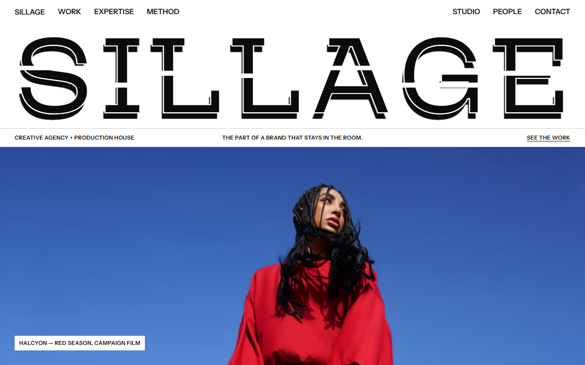
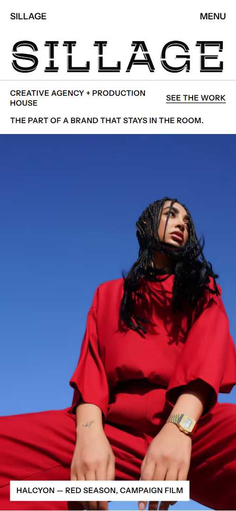

# Free HTML creative agency website template with GSAP scroll animations — Sillage

**Website for a creative agency or production house, with a portfolio, services, team and studio: a free HTML template in one file, with GSAP scroll animations, no build step, MIT license. Made by [8B](https://8b.com/), the AI website builder.**

[](LICENSE)  

**[Live demo](https://8bsite.github.io/creative-agency-website-template/)** · **[Use this template](https://github.com/new?template_name=creative-agency-website-template&template_owner=8bsite)** · **[Download ZIP](https://github.com/8bsite/creative-agency-website-template/archive/refs/heads/main.zip)** · **[Template page on 8b.com](https://8b.com/templates/sillage/)**

<a href="https://8bsite.github.io/creative-agency-website-template/"></a> <a href="https://8bsite.github.io/creative-agency-website-template/"></a>

<p align="center"><a href="https://8bsite.github.io/creative-agency-website-template/"></a><br><sub>Scroll animation</sub></p>

A one-page site for a Paris creative agency and production house working for fashion, beauty and fragrance brands. Black and white, uppercase, hairline-ruled tables, colour only from the photos; the width-filling wordmark carries an offset black trail that splits apart as you scroll, and one project grows from the grid into a full-screen stage.

Good for: creative, advertising or branding agency; photo, film or production company; design or architecture studio portfolio; fashion, beauty or luxury services; a studio or venue that also rents its space.

## Use it with an AI coding agent

Download the files into your project (in Windows PowerShell type `curl.exe`):

```bash
curl -LO https://raw.githubusercontent.com/8bsite/creative-agency-website-template/main/index.html
curl -LO https://raw.githubusercontent.com/8bsite/creative-agency-website-template/main/AGENTS.md
curl -LO https://raw.githubusercontent.com/8bsite/creative-agency-website-template/main/LICENSE
curl -LO https://raw.githubusercontent.com/8bsite/creative-agency-website-template/main/CREDITS.md
```

Then give your agent this prompt:

```text
Read AGENTS.md, then edit index.html. Use this template as the base for a site for <your agency or studio: what you do, for whom, your clients and projects, your team, where you are>. Keep the layout, the motion and the single-file format; replace the brand name and wordmark, copy, projects, client names, people, photos, links and contacts, and recolour it through the CSS variables if needed.
```

Give the agent the downloaded file, not a link: from a link it would rebuild a different page. No agent? Click **[Use this template](https://github.com/new?template_name=creative-agency-website-template&template_owner=8bsite)**, edit `index.html` and turn on **Settings → Pages**.

## What's on the page

- **Navigation** — top bar: wordmark, two groups of section links; phone menu overlay with email and phone
- **Sillage — creative agency and production house I L L A G E** — first screen: width-filling cut wordmark, a ruled info line, a full-bleed campaign photo (demo: SILLAGE)
- **Not what a brand says. What stays in the room.** — four width-filling statement lines, a lead, two paragraphs and a ruled line of six verbs
- **Selected work** — portfolio: a ruled filter bar over an asymmetric grid of eight projects, plus a reel button
- **The Amber Hour** — one featured project on a full-screen stage: tags, giant title, client line, credits, button (demo: The Amber Hour)
- **Houses we keep company with** — a looping row of client names set in the wordmark face
- **Five rooms. One roof.** — dark section: a portrait and five ruled service rows, each with a title and tags
- **From first line to last frame** — four numbered process steps as a horizontal storyboard (demo: Write, Build, Shoot, Finish &amp; scale)
- **Studio Sillage, Montreuil** — a space for hire: large photo, text, five ruled spec rows and a booking button
- **The people in the room** — team: six portraits with names and roles, and a hiring line
- **Tell us what should stay** — contact: the main email as a width-filling line, four ruled desks with names, emails, phones, addresses
- **Footer** — the SILLAGE wordmark again, copyright, social links and the Design: 8B credit

## Design

Palette:        
Fonts: Instrument Sans, Mozilla Headline (Google Fonts). Change both through the CSS variables in the `:root` block at the top of `<head>`. A big display line with `style="--len:N"` fills its width: set N to its new number of characters.

- The wordmark is HTML text, one span per letter with a data-glyph copy for the trail: change the letters in both the hero and the footer and set --len to the number of letters.
- The works filter matches each card's data-tags against the buttons' data-filter values: keep them in sync when you change the categories.

## Before you publish

- Replace everything marked `data-8b-placeholder` (social preview image, favicon, email, phone, social) and the invented demo facts: prices, dates, address. [AGENTS.md](AGENTS.md) lists them.

## Tech

GSAP 3.13.0, ScrollTrigger, Lenis 1.3.27 from jsDelivr, 106 KB, no build step. Chrome and Edge 111+, Safari 16.2+, Firefox 113+ (it uses color-mix(), container query units, cascade layers, small/dynamic viewport units). With "reduce motion" on, the page is complete and still.

## License

MIT, see [LICENSE](LICENSE). Photos, fonts and libraries keep their own licences: [CREDITS.md](CREDITS.md). More free templates: [8b.com/templates](https://8b.com/templates/) · [github.com/8bsite](https://github.com/8bsite).
